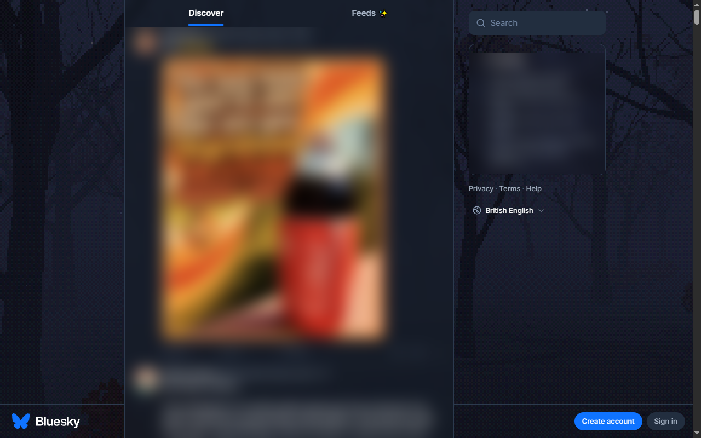
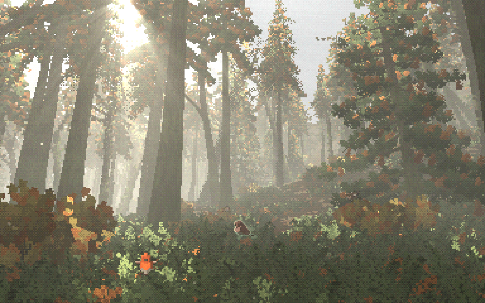
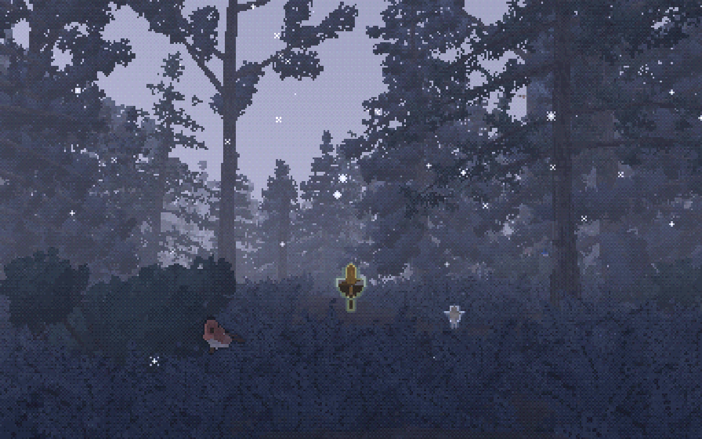
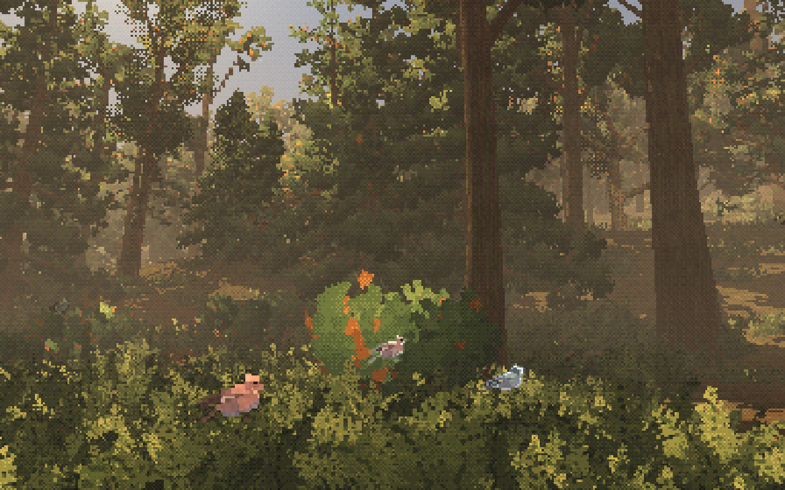
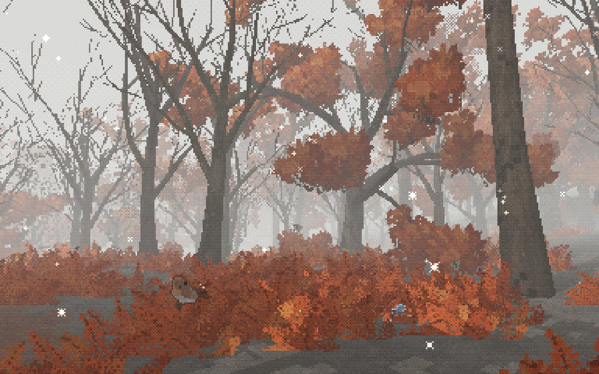

# skytreeone

A browser extension that puts the [playtreeone](https://github.com/TechyBen/playtreeone) PS1-style forest behind [Bluesky](https://bsky.app). The scenes, sun, moon, stars and fog are the same as the treeps1 screensaver, rendered quietly behind your feed. Sound is off by default.

New posts from the people you follow arrive as little birds that settle in the trees: low-poly 3D songbirds, coloured loosely from each account's profile picture and sized by its follower count, flattened into pixel billboards that step between poses every few seconds. Click the little tree button at the bottom right of bsky.app (or **Wander** in the popup) to step into the forest: walk up to a bird to read its post, press **Enter** to open the thread, or **Esc** to go back to your feed.

A sibling of [fightskyone](https://github.com/TechyBen/fightskyone) (a PS1 sky behind Bluesky where posts are jets), from down among the trees.



| Daytime sun | Winter snow |
|---|---|
|  |  |
|  |  |

The snow uses playtreeone's own weather settings (manual snow, cloud and visibility); the extension doesn't switch weather on yet. The birds with a soft green glow are ones you've seen, and blue ones you've read.

## Install (unpacked)

```bash
git clone https://github.com/TechyBen/skytreeone
```

Then in Chrome or Edge, open `chrome://extensions`, turn on **Developer mode**, click **Load unpacked** and pick the `ext` folder. Open bsky.app. There's no build step.

If fightskyone is installed too, switch one of them off in its popup: both put a scene behind the page.

## Just want to see it?

Try the forest on its own with made-up demo birds, without installing anything or signing in:

```bash
python tools/serve.py
```

Then open [http://localhost:8174/tree/index.html?saver&demo=1&wander=1](http://localhost:8174/tree/index.html?saver&demo=1&wander=1). The demo birds' posts say they're demos and explain how to walk about; they use no network and keep their own seen/read marks. Esc stops walking and a click walks again. Add `&style=sparse` for the original open woods, or `&realsun=0` for each scene's own light instead of your real sun and sky.

## Settings (toolbar popup)

| Setting | Default | |
|---|---|---|
| Forest behind Bluesky | on | Switching off restores Bluesky exactly |
| Forest style | Dense | **Dense**: closer stands with trails, hillsides, ferns and moss (dense versions of the original scenes, plus Fern Hollow and Moss Ravine). **Sparse**: the original open woods around a wide clearing |
| Wildflowers | on | The species in flower near you at this time of year, from iNaturalist records built into the extension (nothing is looked up online) |
| Location | blank | `lat, lon` for the sun, seasons and wildflowers, rounded to 0.1°. Blank guesses from your time zone |
| Birds from people I follow | on | Live posts land in the trees as birds |
| Whose follows | blank | Blank uses the account signed in to bsky.app; type a handle to use someone else's follows |
| Sound | off | Wind and birds. Browsers only start audio after a click, so it starts on your next click on Bluesky, and pauses while the tab is hidden |
| Volume | 40% | |
| Feed panel | 70% | Opacity of the blurred panel behind the feed |
| Blur | 6 px | |
| Minutes per scene | 15 | Fog rolls in, a new scene loads behind it |
| Pixel height | 240 | Render height; lower is chunkier and lighter on the GPU |
| Frame cap | 30 fps | |

## Wander mode

| Key | |
|---|---|
| Tree button | Step into the forest, or back out |
| W A S D | Walk and step sideways (Shift to run) |
| Arrow keys | Walk and turn |
| Drag | Look around |
| Enter | Open the post of the bird in front of you |
| Esc | Back to the feed |

## How it works

- `ext/content.js` adds a fixed, click-through `<iframe>` under everything on bsky.app. It loads the extension's own copy of the playtreeone page in screensaver mode (`tree/index.html?saver&audio=0…`).
- Bluesky paints its page colour inline on many nested panels. A stylesheet rule with `!important` makes every panel with that inline colour transparent, plus the navigation screens' near-white or near-black backdrop. Being CSS, it applies before the browser paints, so re-rendered panels never flash. Sticky and fixed bars (the tab bar, the bottom bar) keep a frosted backdrop instead. Fixed overlays like the image viewer are left alone.
- A translucent, blurred panel in the page colour sits behind the feed column, and a faint veil (stronger on the light theme) plus a soft text halo keeps the side columns readable.
- `ext/tree/` holds the forest page. `index.html` and `src/` are copied from playtreeone (the `web` submodule) by `tools/sync_forest.py`: extensions can't load code from a CDN or use inline import maps, so three.js and lil-gui are vendored in `ext/tree/vendor/` and the imports are pointed there. Change those files in playtreeone and sync; `bridge.js`, `chatter.js`, `kit.js` and `birdmodel.js` are this extension's own.
- `ext/tree/chatter.js` runs inside the forest page. It gets your follow list from Bluesky's public API (`app.bsky.graph.getFollows`, cached for six hours) and listens to [Jetstream](https://github.com/bluesky-social/jetstream), Bluesky's public JSON firehose, filtered to those accounts (sent in an `options_update` message, so it works for up to 10,000 follows). It replays the last 3 hours on start so the trees aren't empty, and birds stay up to an hour (the oldest flies off when there are more than 18). Each top-level post becomes a bird. Per account, the low-poly songbird from `ext/tree/birdmodel.js` (built with `ext/tree/kit.js`) is coloured from the profile picture's main colour, lit with the forest's current light and rendered into an atlas of 6 poses x 8 view angles, rebaked when the light changes. Every post goes into a pool (up to 80): new posts land first, and when fewer than 12 birds are around you, older posts land again round robin (least recently shown first), always on perches 7-19 m from wherever you are, so the forest stays full as you walk; birds left 35 m behind fly off. In wander mode a bird you've seen (in front of you, within ~14 m, for a second) gets a green outline, and one whose post you've read (its card open for a moment, or opened) a blue one; these marks are remembered. Birds stand on real perches: fairly level stretches of the trees' own side branches (1-5 m up, out along the branch, not buried in leaves), shrub tops, or the ground, re-chosen when the scene changes. In wander mode, a bird you walk right up to (about 2 steps) without opening flies off after a moment and settles a few metres away. In the forest each bird is a camera-facing quad showing one cell; its pose and view angle step every 2-3 seconds, while canopy shade, fog, and a faint outline rim in the dark are added as it's drawn. If sound is on, each account also gets its own synthesised birdsong voice when its bird lands.
- Wander mode fades Bluesky out and gives the forest the keyboard and mouse. Opening a post sends its address back to the page, which navigates Bluesky's own router to the thread without reloading. Bluesky stays hidden while the thread loads, then fades in once the post itself is on the page; the replies under it fade in one by one as they scroll into view.
- No login, no account access, no analytics, no servers of its own. Live weather is off. See [PRIVACY.md](PRIVACY.md).

To take the latest forest: `git submodule update --init --remote web`, then `python tools/sync_forest.py`, and commit `ext/tree`.

## Testing without installing

`python tools/serve.py` serves `ext/` with the headers a public page needs to load scripts from localhost. The forest page alone: `http://localhost:8174/tree/index.html?saver&demo=1` (demo birds) or `?saver&chatter=1&me=<handle>` (someone's real follows); `window.skytreeChatter` has test hooks. Inject `content.css`, `settings.js` and `content.js` into bsky.app with `window.SKYTREE_TEST_BASE = 'http://localhost:8174/tree/index.html'` set first, and the content script runs with default settings (`window.__skytreeTest.apply({...})` changes them).

## Licences

playtreeone and its star data (d3-celestial, BSD 3-clause), three.js (MIT) and lil-gui (MIT). See `ext/licenses/`.
